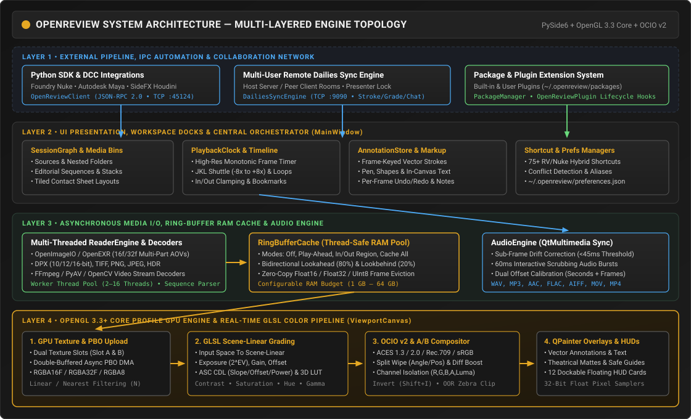
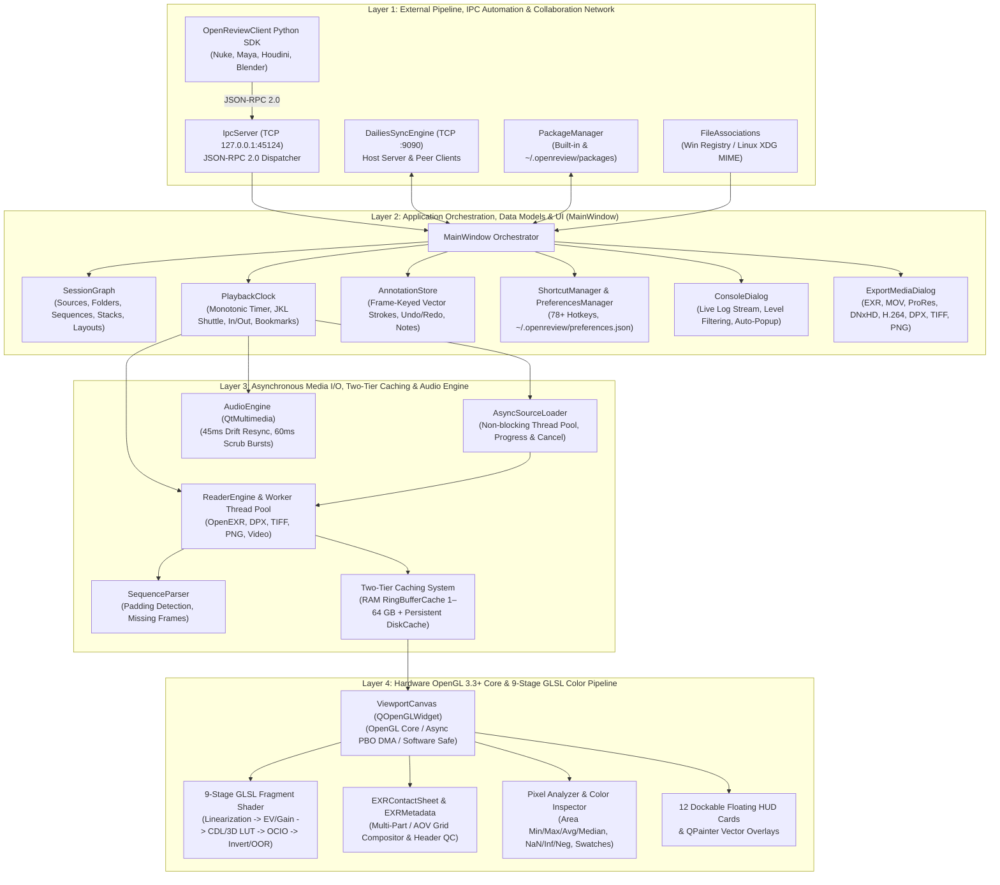

# OpenReview System Architecture Specification

**Author:** Maruthu Chakravarthi  
**Version:** 1.0.1  
**HTML Portal:** [docs/html/index.html](file:///e:/works/Pipeline/code/OpenReview/docs/html/index.html)


OpenReview is a studio-grade visual effects (VFX) sequence playback, high-dynamic-range (HDR) color inspection, multi-source compositing comparison, and collaborative dailies review workstation application built on **Python 3.10+**, **PySide6 (Qt 6)**, **OpenGL 3.3+ Core Profile**, and **OpenColorIO v2**.



---

## 1. Multi-Layered System Topology



---

## 2. Detailed Breakdown of Architectural Subsystems

### 2.1 Layer 1: IPC, Package Management & File Associations
- **JSON-RPC 2.0 IPC Server (`network/ipc_server.py`):** Binds on `127.0.0.1:45124` to receive automation commands from DCC applications (Nuke, Maya, Houdini, Blender) and command-line scripts.
- **PackageManager (`packages/manager.py`):** Dynamically discovers and loads modular studio packages from built-in directories, `~/.openreview/packages/`, or `OPENREVIEW_PACKAGE_PATH`. Includes the built-in `xtra-qc-Utils` (`openreview/packages/builtin/comp_qc/`) suite providing real-time Softclip Knee, frequency-separated grain inspection, high-pass edge filters, and shadow black level elevation (`Q`).
- **System File Associations (`core/file_associations.py`):** Registers shell associations for visual effects formats (`.exr`, `.dpx`, `.cin`, `.tif`, `.tiff`, `.png`, `.jpg`, `.jpeg`, `.mov`, `.mp4`, `.ovr`) across Windows Registry and Linux XDG MIME systems.

### 2.2 Layer 2: Core Orchestration, Diagnostics & Export Pipeline
- **MainWindow (`ui/main_window.py`):** Central coordinator integrating docked panels, floating HUD cards, viewport canvas, and top menu hierarchy (organized and sorted ascendingly by category). Includes low-resolution monitor scaling (down to 1920x1080 FHD) and clean Windows taskbar handling in Fullscreen (`F12`) and Presentation (`Ctrl+P`) modes.
- **Studio About & License Inspector (`ui/about_dialog.py`):** Dedicated dialog (`F1`) detailing architecture, versioning, author attribution (Maruthu Chakravarthi), and interactive master-detail third-party dependency license inspector.
- **SessionGraph (`models/session_graph.py`):** Hierarchical DAG model storing sources, clips, stacks, versions, and multi-view layouts with non-destructive session serialization (`.ovr`).
- **Live Console Window (`ui/console_dialog.py`):** Intercepts standard log streams, provides severity level filtering (DEBUG, INFO, WARNING, ERROR, CRITICAL), and automatically pops up whenever an unhandled error is logged (`Ctrl+Shift+L`).
- **Comprehensive Media Export Engine (`ui/export_media_dialog.py`):** Exports single frames, selected in-out ranges, or entire sequences to OpenEXR, QuickTime MOV (ProRes, DNxHD, H.264), DPX, TIFF, and PNG with selectable downrez scaling, colorspace transforms, and burned-in review annotations.

### 2.3 Layer 3: Asynchronous Media I/O & Two-Tier Caching
- **AsyncSourceLoader (`core/async_source_loader.py`):** Non-blocking background worker that loads heavy multi-part EXR sequences and high-bitrate video containers with cancellation tokens and real-time progress callbacks.
- **Two-Tier Cache Architecture (`core/cache.py`):**
  - **Tier 1 (RAM RingBufferCache):** Fast in-memory frame cache with configurable RAM budget (1 GB to 64 GB) and strategy modes: `Off`, `Play-Ahead` (80% forward / 20% backward), `In/Out Region` (`Shift+C`), and `Cache All`.
  - **Tier 2 (Persistent DiskCache):** Disk-backed frame serialization utilizing fast LZ4/Zstandard compression to cache pre-decoded frames beyond physical RAM boundaries. Includes full cache eviction (`Ctrl+Shift+C`) and global source purge (`Ctrl+Delete`).
- **Sub-Frame Audio Synchronization (`audio/audio_engine.py`):** Precision clock mapping frame numbers to millisecond audio positions. Automatically initiates hard resync when drift exceeds **45ms**, and produces **60ms audio bursts** during interactive timeline scrubbing.

### 2.4 Layer 4: Hardware OpenGL 3.3+ Viewport & Color Science
- **The 9-Stage GLSL Fragment Shader (`color/shader_builder.py`):**
  1. *Dual Texture Sampling & Stereo 3D:* Samples `uTextureA` and `uTextureB` with horizontal disparity offset.
  2. *Interactive Split Wipe & Blending:* Angled split plane (`W`) with *Replace*, *Over*, *Add*, *Difference*, and *Inverted Difference* modes (`0x–20x` boost).
  3. *Linearization:* Cineon, LogC, sRGB, Rec.709, or Gamma 2.2 converted to scene-linear (`ACEScg`).
  4. *Scene-Linear Exposure (EV), Gain & Offset:* `rgb = (rgb * uGain * exp2(uExposureEV)) + uOffset`.
  5. *ASC CDL & Hardware 3D LUT:* Trilinear interpolation in 3D texture space.
  6. *Pivot Contrast, Hue Matrix & Saturation:* Contrast pivoted at 18% grey (`0.18`) with Rec.709 luma preservation.
  7. *OpenColorIO v2 Display Transform:* ACES 1.3/2.0 tone mapping and display gamma.
  8. *Display Invert & Zebra Warnings:* Instant RGB inversion (`Shift+I`) and Magenta/Cyan out-of-range clipping highlights.
  9. *Channel Isolation & Background:* Soloing RGB (`C`), R, G, B, Alpha (`A`), or Luma (`Y`) over transparent or solid backdrops.
- **EXR Multi-Layer Contact Sheet (`core/exr_contact_sheet.py`):** Auto-tiles all AOVs (Diffuse, Specular, Normal, Cryptomatte, Depth) into an interactive contact sheet matrix.
- **Pixel Analyzer & Area Sampler (`widgets/hud_layers.py`):** Rectangular and point eyedroppers calculating real-time Min, Max, Average, and Median statistics with instant detection of `NaN`, `Inf`, and negative values accompanied by preview swatches.
- **Anti-Aliased Vector Annotations:** Freehand pen (`D`) with draft stroke feedback that automatically smooths and anti-aliases paths upon release, paired with frame-accurate notes and non-blocking export.

---

## 3. Persistent Configuration Schema (`~/.openreview/preferences.json`)

User preferences are persisted as JSON in `~/.openreview/preferences.json`:

```json
{
  "playback": {
    "default_fps": 24.0,
    "loop_mode": "loop",
    "real_time": true,
    "play_every_frame": false,
    "scrub_audio_bursts": true
  },
  "caching": {
    "strategy": "play_ahead",
    "ram_budget_gb": 8.0,
    "disk_cache_enabled": true,
    "disk_cache_dir": "~/.openreview/cache",
    "disk_cache_limit_gb": 32.0,
    "prefetch_forward_ratio": 0.8
  },
  "gpu": {
    "engine": "opengl_core",
    "use_pbo": true,
    "texture_format": "RGBA16F"
  },
  "color": {
    "ocio_config_path": "",
    "default_input_colorspace": "ACEScg",
    "default_display": "sRGB",
    "default_view": "ACES 1.0 SDR-video"
  },
  "logging": {
    "log_level": "INFO",
    "auto_open_console_on_error": true
  }
}
```
