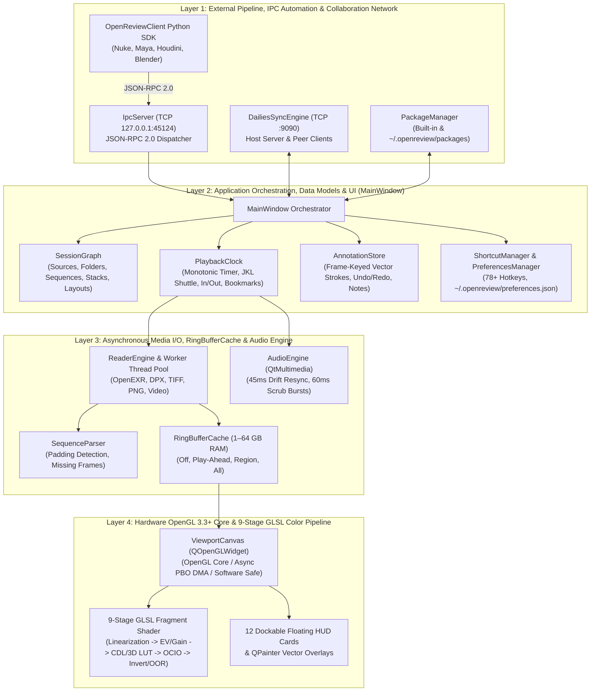
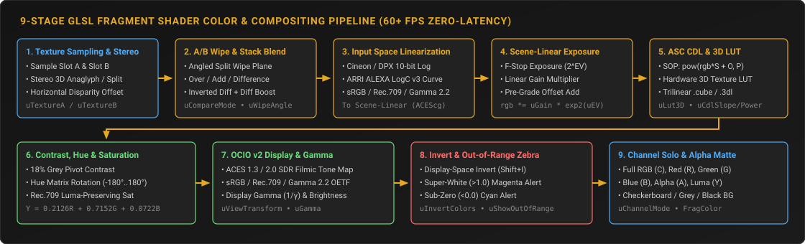
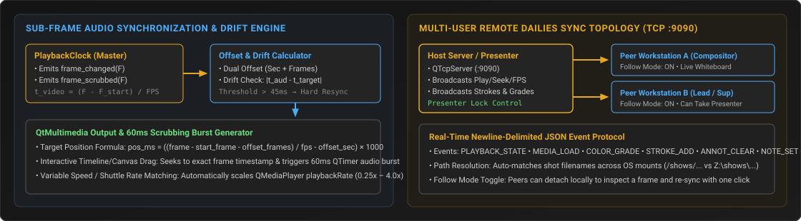

# OpenReview System Architecture Specification

**Author:** Maruthu Chakravarthi  
**Version:** 0.1.0  
**HTML Portal:** [docs/html/index.html](file:///e:/works/Pipeline/code/OpenReview/docs/html/index.html)

OpenReview is a studio-grade visual effects (VFX) sequence playback, high-dynamic-range (HDR) color inspection, multi-source compositing comparison, and collaborative dailies review workstation application built on **Python 3.10+**, **PySide6 (Qt 6)**, **OpenGL 3.3+ Core Profile**, and **OpenColorIO v2**.

---

## 1. Multi-Layered System Topology

---

## 2. The 9-Stage GLSL Fragment Shader Pipeline (`color/shader_builder.py`)

1. **Dual Texture Sampling & Stereo 3D Reconstruction:** Samples `uTextureA` and `uTextureB` (`RGBA16F` / `RGBA32F` / `RGBA8`) and reconstructs Anaglyph, Side-by-Side, or Stereo Difference views with horizontal convergence disparity offset.
2. **Interactive A/B Wipe & Stack Blending:** Evaluates the angled split wipe plane (`uWipePosition`, `uWipeAngle`) or blends layers via *Over*, *Add*, *Difference* (`|A - B| * uDiffBoost`), or *Inverted Difference* (`1.0 - |A - B| * uDiffBoost`).
3. **Input Colorspace Linearization:** Converts Cineon/DPX 10-bit Log, ARRI ALEXA LogC, sRGB, Rec.709, or Gamma 2.2 into scene-linear working space (`ACEScg`).
4. **Scene-Linear Exposure (EV), Gain & Pre-Grade Offset:** Computes `rgb = (rgb * uGain * exp2(uExposureEV)) + uOffset`.
5. **ASC CDL & Hardware 3D LUT (`GL_TEXTURE_3D`):** Evaluates `pow(clamp(rgb * Slope + Offset, 0.0), Power)` followed by trilinear `.cube` / `.3dl` 3D LUT interpolation.
6. **Pivot Contrast, Hue Matrix & Rec.709 Luma Saturation:** Applies contrast around an 18% grey pivot (`0.18`), 3x3 hue rotation, and luma-preserving saturation (`Y = 0.2126R + 0.7152G + 0.0722B`).
7. **OpenColorIO v2 Display View Transform & Gamma:** Applies ACES 1.3 / 2.0 Filmic Tone Map, sRGB, or Rec.709 display transforms and display gamma (`1.0 / uGamma`).
8. **Display Invert (`Shift+I`) & Out-of-Range Zebra Clipping:** Inverts display RGB (`1.0 - rgb`) when `uInvertColors` is active, and flags super-white (`> 1.0`) pixels in Magenta and negative (`< 0.0`) pixels in Cyan.
9. **Channel Isolation & Alpha Background Compositing:** Solos `RGB` (`C`), `Red` (`R`), `Green` (`G`), `Blue` (`B`), `Alpha` (`A`), or `Luminance` (`Y`) over Black, 18% Grey, 50% Grey, White, or Checkerboard canvas backgrounds.

---

## 3. Sub-Frame Audio Synchronization & Remote Dailies Sync

- **Audio Drift Compensation (`audio/audio_engine.py`):** Maps frame numbers to millisecond timestamps using `pos_ms = ((frame - start_frame - offset_frames) / fps - offset_seconds) * 1000`. Automatically executes a hard resync if hardware audio clock drift exceeds **45ms**, and generates **60ms audio bursts** during interactive timeline or canvas scrubbing.
- **Multi-User Remote Dailies Sync (`network/sync_engine.py`):** Host/Client TCP room synchronization (`Ctrl+Shift+D`, default port `9090`) with Presenter lock, Follow mode toggle, live vector stroke broadcasting, color grade mirroring, and room chat.
- **Persistent Storage (`core/preferences.py`):** Stores user settings, GPU playback engine configuration, OCIO paths, bookmarks, and custom shortcut bindings in `~/.openreview/preferences.json` with `QSettings` fallback.
