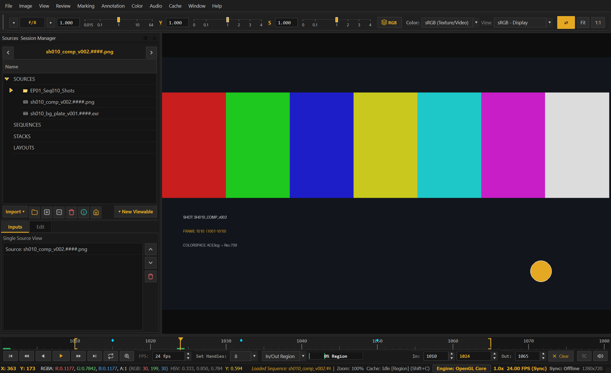
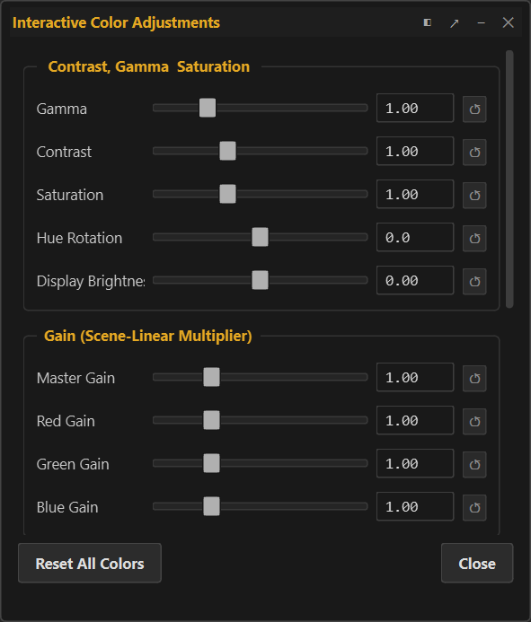
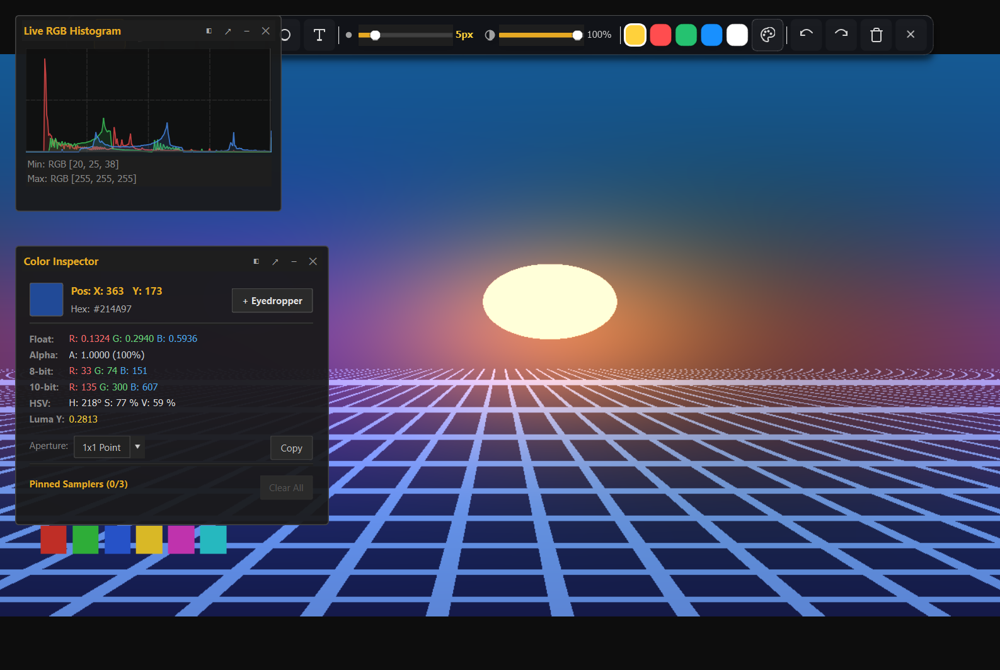
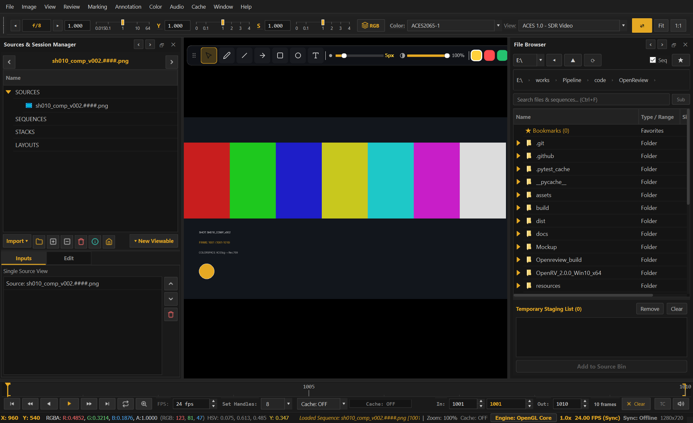
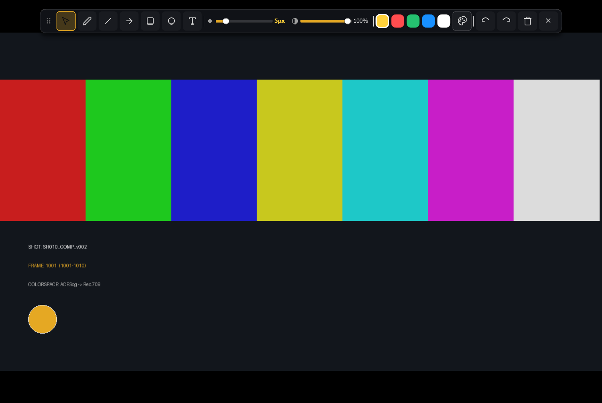
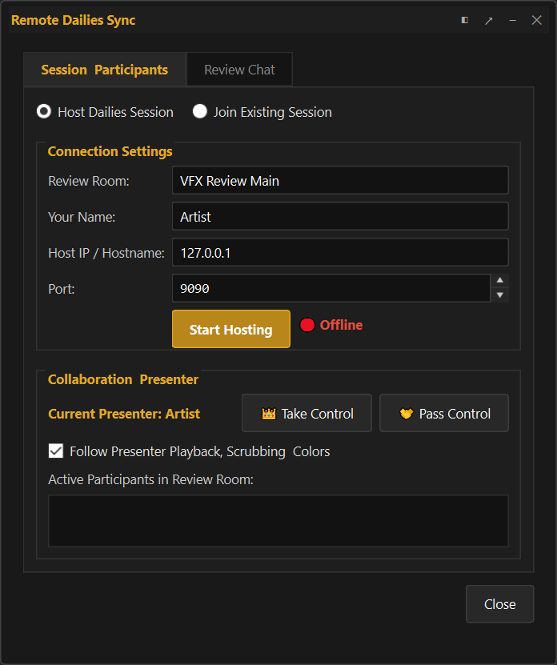

# OpenReview 🎬

<p align="center">
  
</p>

<p align="center">
  <strong>Studio-Grade VFX Sequence Playback, HDR Color Inspection, Multi-Source Compositing Comparison, and Collaborative Dailies Review Desktop Workstation</strong>
</p>

<p align="center">
  <a href="https://github.com/maruthuvfx/OpenReview/releases/latest"></a>
  <a href="https://opensource.org/licenses/MIT"></a>
  <a href="https://python.org"></a>
  <a href="https://www.qt.io/"></a>
  <a href="https://opencolorio.org"></a>
  <a href="https://maruthuvfx.github.io/OpenReview/"></a>
  
</p>

---

## 🌟 Overview

**OpenReview** is an open-source, studio-grade visual effects (VFX) sequence playback, high-dynamic-range (HDR) color inspection, multi-source compositing comparison, and collaborative dailies review desktop workstation application. Built from the ground up on Python 3, PySide6 (Qt 6), and a dedicated OpenGL 3.3+ Core Profile rendering pipeline, OpenReview provides the raw performance, fidelity, and precision demanded by VFX supervisors, compositors, colorists, and lead artists.


*Figure 1: OpenReview unified workstation interface featuring the floating Color HUD, Sources Bin, high-precision Timeline Transport with cached RAM frame indicator, and 32-bit floating point viewport.*

---

## 📦 Binary Downloads & Distribution Matrix

Pre-built standalone distributions for **OpenReview v1.0.0** are hosted directly on **[GitHub Releases](https://github.com/maruthuvfx/OpenReview/releases/tag/v1.0.0)**.

| Platform / Edition | Package Format | Target Architecture | Description | Download |
| :--- | :--- | :--- | :--- | :--- |
| **Windows 64-bit** | `.msi` Installer | `x86_64` (Win 10/11) | Full interactive Windows installer with Start Menu shortcut, desktop icon, and file associations. | [**Download .msi**](https://github.com/maruthuvfx/OpenReview/releases/download/v1.0.0/OpenReview-1.0.0-win64.msi) |
| **Windows 64-bit Portable** | `.zip` Archive | `x86_64` (Win 10/11) | Zero-install standalone directory. Unzip anywhere and double-click `OpenReview.exe` to run. | [**Download .zip**](https://github.com/maruthuvfx/OpenReview/releases/download/v1.0.0/OpenReview-1.0.0-win64-portable.zip) |
| **Linux (Debian / Ubuntu)** | `.deb` Package | `amd64` (Ubuntu 20.04+, Debian 11+) | Native Debian package installing desktop integration, `/opt/openreview`, and terminal launcher. | [**Download .deb**](https://github.com/maruthuvfx/OpenReview/releases/download/v1.0.0/openreview_1.0.0_amd64.deb) |
| **Linux (RHEL / Fedora)** | `.rpm` Package | `x86_64` (RHEL 8/9, Rocky, Fedora) | Standard RedHat package with system desktop entry, MIME types, and icon deployment. | [**Download .rpm**](https://github.com/maruthuvfx/OpenReview/releases/download/v1.0.0/openreview-1.0.0-1.x86_64.rpm) |
| **Python Source** | PyPI / Editable | Cross-platform | Run directly from source in any Python 3.10+ virtual environment. | `pip install -e .` |

---

## 🚀 Key Studio Capabilities

- **Hardware-Accelerated OpenGL 3.3+ Viewport**: Double-buffered Asynchronous Pixel Buffer Object (PBO) DMA texture streaming, native `RGBA16F` / `RGBA32F` floating-point textures, sub-pixel bilinear and nearest filtering, and multi-threaded disk prefetching via `RingBufferCache`.
- **9-Stage GLSL Color Pipeline**: Seamless OpenColorIO v2 (ACES 1.3 / 2.0, ACEScg, ARRI LogC, Cineon, Rec.709, sRGB), F-stop Exposure ($2^{\text{EV}}$), Gain, Offset, Gamma, 18% Midpoint Pivot Contrast, Hue rotation, Saturation, hardware 3D LUTs (`.cube`, `.3dl`), ASC CDL (`.cdl`, `.cc`, `.ccc`), Invert (`Shift+I`), and Out-of-Range zebra warnings.
- **Angled A/B Split Wipes & Difference QC**: Multi-angle split wipe controller (`W`), Difference & Inverted Difference modes with interactive multiplier boost for plate-to-comp alignment and grain inspection.
- **Multi-Source Stacking & Contact Sheet Layouts**: Layer stacking (`Z` / `Shift+Z`) with blend modes (Over, Add, Multiply, Screen), plus automatic multi-tile contact sheets (`Auto Grid`, `Side-by-Side`, `Over/Under`, `2x2`, `3x3`).
- **32-Bit Float Pixel Probe & Area Samplers**: Real-time cursor pixel readout (`RGBA` + Luminance) with pinned point and rectangular area samplers (`F5`), min/max/mean statistical readouts, and instant `NaN` / `Inf` / Negative pixel detection.
- **Vector Markup & Frame Annotations**: Freehand pen (`D`), line, arrow, rectangle, circle, and in-canvas text callouts (`X`) with per-frame Undo/Redo and multi-format media export (`Ctrl+Shift+E`).
- **Multi-User Remote Dailies Sync**: TCP multi-client synchronized playback (`Ctrl+Shift+D`), scrubbing, frame jumping, and annotation sync for studio review rooms.
- **Sub-Frame Audio Engine**: 60ms scrubbing audio bursts, 45ms drift auto-resynchronization, and seconds + frames offset calibration.

---

## 📸 Visual Showcase & Feature Captions

<table width="100%">
<tr>
<td width="50%" valign="top">
  
  <p align="center"><em><strong>Figure 2: Angled A/B Split Wipe Mode</strong><br>Real-time comparative review of Plate vs. Comp with interactive angle rotation, position slider, and difference overlays.</em></p>
</td>
<td width="50%" valign="top">
  
  <p align="center"><em><strong>Figure 3: Floating Color Science HUD</strong><br>9-stage GLSL pipeline with live exposure F-stop, gain, gamma, saturation, and OCIO v2 color space transform selector.</em></p>
</td>
</tr>
<tr>
<td width="50%" valign="top">
  
  <p align="center"><em><strong>Figure 4: Resolution-Independent Vector Markup</strong><br>Floating tool palette with freehand pen, geometric arrows, callouts, and frame-accurate review notes.</em></p>
</td>
<td width="50%" valign="top">
  
  <p align="center"><em><strong>Figure 5: Integrated Studio Sequence Browser</strong><br>Collapses complex VFX image sequences (`shot_v001.%04d.exr [1001-1150]`) into single playable clips.</em></p>
</td>
</tr>
<tr>
<td width="50%" valign="top">
  
  <p align="center"><em><strong>Figure 6: Out-of-Range & NaN Warning Mode</strong><br>Real-time false color zebra stripes identifying illegal negative values, clipping whites, and float NaNs.</em></p>
</td>
<td width="50%" valign="top">
  
  <p align="center"><em><strong>Figure 7: Collaborative Remote Dailies Sync</strong><br>TCP room hosting and client connectivity for real-time multi-artist frame scrubbing and dailies review.</em></p>
</td>
</tr>
</table>

---

## ⌨️ Essential Keyboard Shortcuts

| Category | Action | Primary Key | Secondary / Aliases |
| :--- | :--- | :--- | :--- |
| **Playback** | Toggle Play / Pause | `Space` | `K` (stop) |
| **Playback** | JKL Variable Shuttling | `J` (Reverse) / `K` (Stop) / `L` (Forward) | `Shift+L` (Fast Forward) |
| **Playback** | Frame Step / 10-Frame Step | `Left` / `Right` | `Shift+Left` / `Shift+Right` |
| **Playback** | Jump to First / Last Frame | `Home` / `End` | `Ctrl+G` (Go to Frame) |
| **Channels** | View Channel | `C` (RGB) / `R` / `G` / `B` / `A` (Alpha) | `Y` (Luminance) |
| **Color** | Exposure Up / Down (±0.25 EV) | `Alt++` / `Alt+-` | `E` / `Ctrl+Alt+E` (Reset) |
| **Color** | Gain Up / Down (±0.10) | `+` / `-` | `Shift+Home` (Reset All) |
| **Color** | Gamma Up / Down (±0.05) | `Shift++` / `Shift+-` | `Ctrl+Alt+G` (Reset Gamma) |
| **Color** | Toggle Invert Colors | `Shift+I` | |
| **Color** | Open Color Adjustments HUD | `/` | |
| **View** | Fit to Window / 100% 1:1 Scale | `F` / `1` | `Alt+F` (Fit Width) / `Ctrl+1` |
| **View** | Zoom Presets | `Ctrl+2` (200%) / `Ctrl+4` (400%) | `Ctrl+8` (800%) |
| **View** | Flop Horizontal / Flip Vertical | `Shift+X` / `Shift+Y` | |
| **View** | Aspect Ratio Mask / Matte Opacity | `Ctrl+M` | `Shift+M` |
| **View** | Safe Area Overlays / Onion Skinning | `Shift+G` | `Shift+O` |
| **View** | Borderless Fullscreen / Presentation | `F12` | `Ctrl+P` |
| **Marking** | Set In / Set Out Point | `[` / `]` | `\` (Clear In/Out) |
| **Marking** | Add Bookmark / Navigate Bookmarks | `M` | `Alt+Left` / `Alt+Right` |
| **Stacks** | Cycle Stack Layer (Prev / Next) | `Z` / `Shift+Z` | `Alt+Up` / `Alt+Down` (Version) |
| **HUDs** | Toggle Sources Bin / File Browser | `` ` `` (Backtick) | `Ctrl+B` |
| **HUDs** | A/B Split Wipe Toggle / Wipe Angle | `W` | `Shift+W` (Flip Orientation) |
| **HUDs** | Color Inspector / Pixel Probe | `F5` | `Alt+C` |
| **HUDs** | Histogram / Source Details | `H` | `I` |
| **HUDs** | Remote Dailies Sync Room | `Ctrl+Shift+D` | |
| **Markup** | Annotation Toolbar / Pen Tool | `X` | `D` |
| **Markup** | Undo / Redo Annotation Stroke | `Ctrl+Z` | `Ctrl+Shift+Z` (`Ctrl+Y`) |
| **Export** | Export Frame / Sequence / Annotations | `Ctrl+Shift+E` | |

---

## 💻 Running from Source

### Prerequisites
- Python 3.10, 3.11, or 3.12 (64-bit)
- OpenGL 3.3 Core Profile compatible GPU driver
- Git

### Installation

```bash
# 1. Clone the repository
git clone https://github.com/maruthuvfx/OpenReview.git
cd OpenReview

# 2. Create and activate a clean virtual environment
python -m venv .venv

# Windows:
.venv\Scripts\activate

# Linux / macOS:
source .venv/bin/activate

# 3. Install in editable development mode
pip install -e .

# 4. (Optional) Install development & test dependencies
pip install -e ".[dev]"

# 5. Launch OpenReview
openreview
# or:
python run.py
```

### Running Automated Tests

```bash
# Run the test suite with short tracebacks
pytest -q --tb=short
```

---

## 🔌 Studio DCC Integration (Nuke, Maya, Houdini, Blender)

OpenReview provides a native JSON-RPC 2.0 socket server on port `45124`. The bundled Python SDK enables one-click media submission and synchronized playback from studio DCC tools.

### Example: Foundry Nuke Quick-Send (`menu.py`)

```python
import nuke
from openreview.sdk import OpenReviewClient

def send_read_node_to_openreview():
    node = nuke.selectedNode()
    if node.Class() == "Read":
        file_path = nuke.filename(node)
        client = OpenReviewClient()
        client.open_media(file_path)
        client.bring_to_front()

nuke.menu("Nuke").addCommand("OpenReview/Send Selected Clip", send_read_node_to_openreview, "ctrl+shift+r")
```

---

## 📄 License & Attribution

OpenReview is open-source software licensed under the **[MIT License](LICENSE)**.

**Created & Maintained by:**  
**Maruthu Chakravarthi** ([@maruthuvfx](https://github.com/maruthuvfx))  
Portfolio & Contact: [github.com/maruthuvfx](https://github.com/maruthuvfx)

Copyright (c) 2026 Maruthu Chakravarthi.
